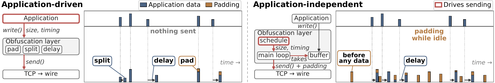
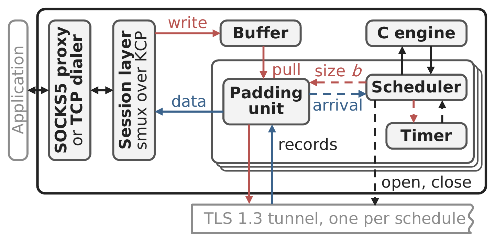

# obfsgen

**A schedule-driven obfuscator for encrypted tunnels** 

Preprint: https://arxiv.org/abs/2611.15019

**Q: What is obfsgen?**

A: obfsgen is an obfuscation tool for tunneled traffic. Unlike existing
obfuscators, obfsgen takes a generative approach to obfuscation, in which it
trains a model on traffic that is considered *normal* and then shapes the
tunneled traffic towards that normal traffic.

**Q: Why yet another obfuscator?**

A: The design principle of obfsgen is to decouple the obfuscation layer from the
application layer. Existing obfuscators are *application-driven*, in that each
`write()` of the application triggers the obfuscation layer to pad, split or
delay the data it is handed. Such an obfuscator can only add to the shape the
application creates, so bursts can grow and delays can lengthen but never the
reverse, and the shape of the tunneled traffic stays visible on the wire.
obfsgen instead keeps its own schedule of when to send each TLS record and how
large the record is, independent of the application. The application's bytes
fill the scheduled records, which are padded when there is nothing to send, so
the tunnel can send before the application writes, keep sending while the
application is idle, and hold data back while the schedule is quiet.



Red marks what drives sending. In an application-driven obfuscator (left), each
`write()` of the application invokes the obfuscation layer. In obfsgen (right),
the schedule drives the main loop, which takes pending application data from
the buffer and pads the rest.

Practitioners have argued for an obfuscator like this for years:
- In 2017, David Fifield showed that obfs4 could queue Tor's data in a send
  buffer and send it on a schedule of its own, with padding when the buffer is
  empty, and released a proof of concept that sends at a constant rate
  ([tor-dev](https://lists.torproject.org/pipermail/tor-dev/2017-June/012310.html)).
- In 2019, Fifield wrote that "a separate timing/size protocol is needed",
  which sends a data packet when the packet-size scheduler leaves room for it
  and padding otherwise
  ([net4people/bbs#9](https://github.com/net4people/bbs/issues/9#issuecomment-524095186)).
- In 2023, the developer of Restls argued that padding "can only increase the
  length of the packets" and leaves the pattern of the TLS handshake unchanged,
  and proposed scripts that set the length of each early packet, padding
  shorter data and truncating longer data
  ([Restls-Script](https://github.com/3andne/restls/blob/main/Restls-Script%3A%20Hide%20Your%20Proxy%20Traffic%20Behavior.md)).
- In 2024, Xue et al. evaluated how well encapsulated TLS handshakes (TLS over
  TLS) identify obfuscated proxy traffic, and discussed why obfuscation that
  depends on the application cannot remove them, since padding and multiplexing
  reduce neither the size of bursts nor the number of round trips
  ([USENIX Security 2024](https://www.usenix.org/conference/usenixsecurity24/presentation/xue-fingerprinting)).
  In 2025, the same authors showed that because the timing obfuscation of obfs4
  is application-driven, it makes the timing fingerprint of proxy traffic more
  pronounced, not less
  ([NDSS 2025](https://www.ndss-symposium.org/ndss-paper/the-discriminative-power-of-cross-layer-rtts-in-fingerprinting-proxy-traffic/)).


**Q: Why does no widely used obfuscator work this way?**

A: Because it has been unclear what shape such an obfuscator should send. Existing (application-driven) obfuscators do not have to confront this problem, because the shape of their traffic is whatever their padding, splitting and delays produce on top of the application's writes, but an obfuscator that keeps its own schedule must commit to a shape before it sends anything.

**Q: What is a good shape, then?**

A: A good shape is that of the traffic the tunnel will be compared against.
That traffic depends on two things: (1) the *cover protocol*, i.e. the
outermost protocol exposed on the wire, and (2) the position from which
detection or fingerprinting is done, and what is visible from there. For
example:
- Against an observer at a network's gateway, collect the background traffic
  seen at that gateway and treat it as normal.
- To make tunneled traffic look like a specific protocol, such as DNS over
  TLS, replicate the shape of that protocol's traffic.
- To pass as a particular website, replicate the shape of that website's
  traffic.

obfsgen does not define what normal is. It is a framework for turning a sample of
whatever is considered normal into generative obfuscation.

**Q: Why a generative model, rather than replaying recorded traffic?**

A: Replaying flows from a sample of normal traffic seems simpler, since every replayed flow is a real one. A pool of N recorded flows, however, gives each tunnel flow at most log₂ N bits of entropy (one choice among N flows), or about 20 bits for a million flows. Each additional bit thus requires twice as many recorded flows, whereas the entropy of normal traffic grows with every record of a flow.

Normal traffic also keeps producing shapes that no recording has seen before (a long tail of rare shapes). In contrast, a pool holds only a sample of that tail. The rare shapes in the pool therefore take the place of the many rare shapes that the pool missed. Which means those rare shapes that got into the sample would recur several times as often as they would in normal traffic. An observer who obtains the pool, for example because it ships with the tool, can look for these shapes.

On the other hand, a generative approach like obfsgen learns how each record follows the ones before it, and composes each new flow * one record at a time *. It is thus not limited to the flows it has seen. More, the entropy of its flows grows with their length rather than with the size of a pool.

**Q: How do I get started?**

A: To try obfsgen with the default models (trained on the traffic of a
[campus gateway](#campus-gateway)), go straight to
[Part 2](#part-2-the-endpoint).

A: To start from scratch and define your own normal,
[docs/tutorial.md](docs/tutorial.md) covers training obfsgen on custom reference
traffic, step by step, with the [dns-over-tls](#dns-over-tls) example.

## Disclaimer

**This tool is NOT production ready.** It is a preview, released to get
feedback from the community. It has not been audited for security. Its traffic
model reflects the network where the training traffic was captured. Do not
rely on it where being detected carries serious risk.

## Overview

The repository has two parts. They meet at a **parameter folder** in
[`params/`](params): the trained models, written by the model part and read by
the endpoint. Part 3 describes the parameter folders that come with the
repository.

| Part | Directory | Input → output | Language |
|---|---|---|---|
| 1. Model | [`model/`](model) | reference traffic → trained models → parameter folder | Python, Zeek |
| 2. Endpoint | [`endpoint/`](endpoint) | parameter folder → obfsgen client and server | Go, C |
| 3. Examples | [`params/example/`](params/example) | parameter folders, ready to use | |

```
             Part 1: model/                                          Part 2: endpoint/
 traffic ──▶ Zeek logs ──▶ dataset ──▶ models ──▶ params/<name>/ ──▶ obfsgen client and server
```

The *reference traffic* is the TLS traffic the tunnel should look like, for
example the traffic of the network where the tunnel will run. To run the
endpoint with an example, such as the default
[campus-gateway](#campus-gateway), go straight to [Part 2](#part-2-the-endpoint).
[docs/tutorial.md](docs/tutorial.md) covers training obfsgen on custom
reference traffic, step by step, with the [dns-over-tls](#dns-over-tls)
example.

## Part 1: The model

### How it works

- **Data.** Zeek records every TLS record of every connection.
  `build_dataset.py` turns each connection into a sequence of tokens, one token
  per record: a size bin and a time bin. Gaps between records are measured
  with the round trip taken out, so the model learns how endpoints behave, not
  how far apart they are.
- **Model.** A Mamba sequence model predicts the next record's size, and then
  its timing given the size. A flow ends with an end-of-flow token.
- **Two modes.** `train.py` builds one model per mode.
  - *Synchronous:* both ends follow one schedule, sampled from a shared seed.
  - *Asynchronous:* each end samples its own records and reacts to what it
    receives.
- **Parameters.** `export.py` writes both models into a parameter folder: the
  PyTorch checkpoints, the weights in int8 for the endpoint, the tokenizers,
  and the distribution of the first record's size.

### Requirements

- Linux and Python 3.10 or newer: `pip install -r model/requirements.txt`.
- [Zeek](https://zeek.org/get-zeek/) 8.0 to capture traffic: your
  distribution's packages, `brew install zeek`, or the `zeek/zeek` Docker image.
- An NVIDIA GPU and the [mamba-ssm](https://github.com/state-spaces/mamba)
  kernels to train: `pip install mamba-ssm causal-conv1d`. Without a prebuilt
  wheel for your CUDA and PyTorch versions, build them from source.

All settings are in [model/config.yaml](model/config.yaml). Every command
takes `--config` to read a copy. The commands below run from the repository
root.

### 1. Capture the reference traffic as Zeek logs

The Zeek script [model/capture/obfsgen.zeek](model/capture/obfsgen.zeek) logs
every TLS record and TCP packet. There are two ways to run it.

**Option A: live traffic, with Zeek.** For a capture of days or more, run the
script under zeekctl. Set the interface in zeekctl's `node.cfg`, then:

```bash
echo "@load $PWD/model/capture/obfsgen.zeek" >> "$(zeek-config --site_dir)/local.zeek"
zeekctl deploy
```

zeekctl rotates the logs every hour into its archive, one directory per day
(`<zeek prefix>/logs/<date>/`). `build_dataset.py` reads the archive as it is.
For a short capture, run Zeek in the foreground until Ctrl-C:

```bash
mkdir -p logs/live && cd logs/live && sudo zeek -C -i eth0 ../../model/capture/obfsgen.zeek
```

**Option B: your PCAP files, with a script.**
[model/capture/pcaps.sh](model/capture/pcaps.sh) runs Zeek over every pcap,
in parallel, into one log directory per pcap. A rerun skips the pcaps already
done.

```bash
model/capture/pcaps.sh -o logs/ traces/         # traces/: .pcap and .pcapng files, searched recursively
```

### 2. Build the dataset

Train/val/test splits, the two tokenizers, and the distribution of the first
record's size over the training flows:

```bash
python model/build_dataset.py logs/ -o data/
```

### 3. Train

One model per mode:

```bash
python model/train.py data/ --form async -o runs/async
python model/train.py data/ --form sync -o runs/sync
```

### 4. Export the parameter folder

```bash
python model/export.py --async runs/async --sync runs/sync --data data/ -o params/my-network/
```

`export.py` writes everything the two parts share into one folder:

```
params/my-network/
├── async/                 the asynchronous model
│   ├── model.pt           PyTorch checkpoint
│   ├── weights.obfw       the same weights, for the endpoint's engine
│   └── tokenizer.json     the size and time bins
├── sync/                  the synchronous model: the same three files
└── opener.json            the sizes of the first record
```

- **`model.pt`** is the run's checkpoint with the lowest validation loss: the
  weights, the model's dimensions, its tokenizer, the `model` and `train`
  settings, the epoch and the validation loss. `score.py` reads it.
- **`weights.obfw`** holds the same weights in the engine's format: the
  matrices in int8 with one scale per row (`export.dtype: fp32` keeps them in
  fp32), everything else in fp32.
- **`tokenizer.json`** holds the edges of the size and time bins, and for each
  bin the values it received in training. Turning a bin back into bytes or
  seconds draws from these values.
- **`opener.json`** holds the size of the first record of every training flow
  that the client opens, as sizes and counts, and the number of training flows
  that the server opens.

Both ends of the endpoint then use the folder with `-params params/my-network`.

### 5. Score traffic

The mean negative log-likelihood of each flow under a model: lower means
closer to the reference traffic. The input is a dataset split or Zeek logs,
for example of a running endpoint.

```bash
python model/score.py params/example/campus-gateway/async logs/obfsgen/ -o scores.csv
```

## Part 2: The endpoint

### How it works

- **Client and server.** The client is a local SOCKS5 proxy. Application
  streams travel over smux and KCP, inside TLS 1.3 connections to the server.
- **One schedule per connection.** A client keeps several TLS connections
  open, each with its own schedule. A connection draws a seed; the seed gives
  the size of its first record, from the distribution in the parameter folder,
  and in synchronous mode the whole schedule. The records then follow the
  schedule, each padded to its scheduled size, and the connection closes at
  the end-of-flow token.
- **Engine.** The model runs in a dependency-free C engine. One decision takes
  under a millisecond on one CPU core.



Red arrows carry outgoing data and blue arrows incoming data. Each TLS
connection has its own scheduler, timer and padding unit (the stacked box):
the scheduler asks the engine for each record's size and time, and the padding
unit fills the record from the buffer.

### Build

Requirements: Go 1.26 or newer and a C compiler. In the repository root:

```bash
go -C endpoint build -o ../obfsgen .                                  # ./obfsgen
CGO_CFLAGS="-O3 -march=native" go -C endpoint build -o ../obfsgen .   # with this CPU's SIMD
ZIG="python3 -m ziglang" endpoint/scripts/build-server.sh             # Linux server package in endpoint/dist/
```

- **SIMD.** The engine uses AVX2, AVX-512 or NEON when the compiler targets
  them, and plain C otherwise.
- **Server package.** `build-server.sh` cross-compiles static binaries with zig
  (`pip install ziglang`) and adds the parameter folder (`PARAMS=...` picks
  another one).

The release provides the Linux server package. On Linux its binaries also run
the client; on other systems, build the client as above.

### Parameter folder

Both ends load one parameter folder when they start: `-params DIR`, by default
`params/example/campus-gateway` (relative to the working directory). They read
`weights.obfw` and `tokenizer.json` of both models and `opener.json`; the
`model.pt` files are not used.

- **The same folder at both ends.** Each connection's first record is drawn
  from a seed, and in synchronous mode the client sends the seed and the
  server samples the same schedule from it. A synchronous-mode server rejects
  a connection whose first record does not match its seed.
- **On a server** installed from the package, the folder is in
  `/usr/local/share/obfsgen`. `build-server.sh` adds it to the package without
  the `model.pt` files.

### Settings

The endpoint's settings are in [endpoint/config.yaml](endpoint/config.yaml):
the client's mode and number of connections, timeouts, the asynchronous
scheduler's deadline, and KCP. They are built into the binary. `-config FILE`
reads changes from a copy; the keys it leaves out keep their values. For
example, a client in synchronous mode with 8 connections:

```bash
printf 'client:\n  mode: sync\n  conns: 8\n' > client.yaml
./obfsgen client -config client.yaml -server IP:443 -sni example.com -pin PIN -psk-file psk
```

### Server (Linux with systemd)

```bash
tar xzf obfsgen-server-<version>.tar.gz && cd obfsgen-server-<version>
sudo ./install.sh                                  # port 443, certificate name example.com
sudo PORT=8443 NAME=cdn.example.org ./install.sh   # or choose them
```

`install.sh` does five things:
- picks the binary for the CPU (AVX2, portable x86-64 or ARM64) and installs
  it with the package's parameter folder (in `/usr/local/share/obfsgen`);
- creates a self-signed certificate and a random pre-shared key in
  `/etc/obfsgen`;
- installs and starts the `obfsgen` systemd service;
- prints the client settings;
- prints an import link `obfsgen://PSK@IP:PORT?sni=NAME&pin=PIN`.

Notes for running the server:
- **Firewall.** Open the TCP port; no UDP is used.
- **Reinstalling** keeps `/etc/obfsgen`, so the key and the link stay the same.
- **Real certificate.** Put the chain and key at `/etc/obfsgen/cert.pem` and
  `key.pem`, delete `/etc/obfsgen/pin` and restart. Clients then leave `-pin`
  empty and use the certificate's domain as `-sni`.
- **Operation.** Use `systemctl status obfsgen`, `journalctl -u obfsgen -f` and
  `systemctl restart obfsgen`.

### Client

In the repository root:

```bash
printf %s 'PSK' > psk
./obfsgen client -server IP:443 -sni example.com -pin PIN -psk-file psk -socks 127.0.0.1:1080
```

Then point applications at the SOCKS5 proxy, for example
`curl --socks5-hostname 127.0.0.1:1080 https://example.com/`.
- **`-pin`** is that of a self-signed server certificate; leave it empty to
  verify the certificate against `-sni` as usual.
- **`-params`** must name the same parameter folder as the server's; the
  default is `params/example/campus-gateway`.

**TUN proxies.** A local TUN proxy (Clash, Surge, …) that sniffs SNI may send
the connection to the real `example.com`, and the client then reports
`certificate pin mismatch`. Either exempt the server's IP from sniffing, or
use `-sni IP`; the certificate is then checked by its pin alone.

## Part 3: Examples

Each example is a parameter folder in `params/example/<name>/`, trained on one
reference traffic. Use one with `-params` at both ends, or score traffic
against it with `score.py`.

| Example | Reference traffic | Flows |
|---|---|---|
| [campus-gateway](#campus-gateway) | TLS traffic at the gateway of a university campus, 33 days | 26.0 M |
| [dns-over-tls](#dns-over-tls) | DNS-over-TLS lookups to eight public resolvers, 6 hours | 0.43 M |

More examples will follow. Each comes with its folder, a row in this table and
a section below with the same parts: reference, capture, dataset, models.

### campus-gateway

**Reference.** The TLS traffic that crosses the gateway of a university
campus network. It suits a tunnel that should look like the campus's TLS
traffic to an observer outside the gateway that applies one classifier to all the
traffic it sees there.

**Capture.** On one core switch of the campus network, port mirroring sent a
copy of sampled traffic to a capture point. Sampling was per flow, so both
directions of a flow were kept or dropped together. The capture point ran Zeek
with [obfsgen.zeek](model/capture/obfsgen.zeek) on TCP port 443: the times, sizes,
sequence numbers and flags of every packet, and the type, length and offset of
every TLS record, without payload. The capture covered 33 days.

**Dataset.**
- 45.5 M connections were logged. The checks removed 36.9 % (no complete TCP
  and TLS handshake), 3.7 % (no data in both directions, or a gap in the byte
  stream) and 2.3 % (fewer than three application-data records, or more than
  500,000 packets).
- 26.0 M flows remain, with 298.8 M application-data records, from 17,954
  client addresses to 29,017 server names.
- By server name: campus services 21 % of the flows; AI assistants, developer
  tools and cloud services 16 %; system services 13 %; finance 13 %; office,
  mail and storage 8 %; messaging and social networks 4 %; web 3 %; names not
  identified 15 % and flows without a name 6 %.
- A fixed random split: 23.4 M flows for training, 1.3 M each for validation
  and test. In 93 % of the flows the models were trained on, the client sends
  the first record.
- The dataset is not released.

**Models.** Both have 15 Mamba blocks of width 256 and 7.1 M parameters (8.8 MB
at int8). Each was trained for 20 epochs, keeping the weights with the lowest
validation loss.

| | async | sync |
|---|---|---|
| Training streams | 46.4 M (507 M tokens) | 23.2 M (253 M tokens) |
| Size / time bins | 159 / 22 | 153 / 22 |
| Validation loss (nats per token) | 1.194 | 1.159 |
| Training time, one GPU | about 60 h | about 30 h |

### dns-over-tls

**Reference.** DNS-over-TLS (DoT) lookups from one client to eight public
resolvers. It suits a tunnel that should look like a DoT client's traffic on
TCP port 853. Unlike web traffic, a DoT connection is short, and each resolver
answers with its own fixed sequence of records.

**Capture.** A lookup client on one host went down the Cisco Umbrella list of
the top one million domain names (snapshot of 2026-11-13) in rank order. It
looked up each name for three record types: A, AAAA and HTTPS.
- **One connection per lookup.** Each lookup had its own TLS connection to a
  resolver picked at random: connect to port 853, send the query, read the
  answer, close. Nothing was cached and no connection was reused.
- **Resolvers.** Cloudflare, Google, Quad9, AdGuard (unfiltered), OpenDNS,
  DNS.SB, Mullvad and AliDNS.
- **Queries.** They set the DNSSEC OK flag and carried no padding option, so
  only the resolvers that always pad padded their answers.
- **Rate.** The client started 20 lookups per second for 6 hours.

Zeek ran [obfsgen.zeek](model/capture/obfsgen.zeek) on the same host, on TCP port
853.

**Dataset.**
- 432,003 lookups of 144,001 names. 0.3 % failed, mostly by timeout. Of the
  answers, 94 % reported no error and 5 % said that the name does not exist.
- Zeek logged 433,320 connections. The checks removed 0.6 % (no complete TLS
  handshake) and 6 connections with fewer than three application-data records.
- 430,736 flows remain, 12.4 % to 12.6 % of them to each resolver, with
  2.05 M application-data records.
- A fixed random split: 387,712 flows for training, 21,594 for validation and
  21,430 for test. The client sends the first record in all but 9 of the
  training flows.
- The Zeek logs are in [datasets/dns-over-tls/zeek](datasets/dns-over-tls/zeek)
  (142 MB, gzip), with the capture host's address replaced by 192.0.2.1.
  `python model/build_dataset.py datasets/dns-over-tls/ -o data/dot/` rebuilds
  this dataset exactly.

Each resolver has its own sequence of records. The table gives the most common
one per resolver: → is client to server, ← server to client, and the numbers
are record sizes in bytes. The query's size depends on the name; 445, 539,
266, 282 and 250 are session tickets, 19 is a closing alert, and a padded
answer is padded to blocks of 468 bytes.

| Resolver | Records of a lookup |
|---|---|
| AdGuard | → query, ← answer, → 19 |
| AliDNS | → query, ← 19, ← answer, → 19, ← 19 |
| Cloudflare | → query, ← 445, ← padded answer, → 19 |
| DNS.SB | → query, ← two tickets of 266 or 282, ← answer, → 19 |
| Google | → query, ← 539, ← answer, → 19 |
| Mullvad | → query, ← 266, ← 266, ← answer, → 19 |
| OpenDNS | → query, ← 250, ← 250, ← padded answer, → 19, ← 19 |
| Quad9 | → query, ← 266, ← 266, ← answer, → 19, ← 19 |

**Models.** Both have 4 Mamba blocks of width 128 and 0.57 M parameters (1.0 MB
at int8). Each was trained for 20 epochs, keeping the weights with the lowest
validation loss. Three settings differ from
[model/config.yaml](model/config.yaml): `model.n_layers: 4`,
`model.d_model: 128` and `train.chunk_batches: 1`. The last one fills every
batch with flows in random order. With the default, a batch holds flows of
similar length; here a flow's length almost tells its resolver, and such
batches taught the model wrong shares of the resolvers.

| | async | sync |
|---|---|---|
| Training streams | 775,424 (4.46 M tokens) | 387,712 (2.23 M tokens) |
| Size / time bins | 150 / 21 | 124 / 21 |
| Validation loss (nats per token) | 1.822 | 1.818 |
| Training time, one GPU | about 15 min | about 8 min |

**Use.** Give both ends `-params params/example/dns-over-tls`. For a server
package with this folder, run `build-server.sh` with
`PARAMS=params/example/dns-over-tls`, and install it with `PORT=853` to use
the DoT port.

## Repository layout

```
docs/                     tutorial.md: training obfsgen on custom reference traffic
datasets/                 the Zeek logs of the examples' reference traffic (dns-over-tls)
params/                   parameter folders: trained models, written by Part 1, read by Part 2
  example/                the examples of Part 3
model/                    Part 1 (Python)
  config.yaml             every setting of the pipeline
  build_dataset.py,       the commands
  train.py, export.py,
  score.py
  capture/                obfsgen.zeek (the Zeek script) and pcaps.sh
  representation/         Zeek logs → flows → record streams → tokens
  seqmodel/               the Mamba sequence model and its data loading
endpoint/                 Part 2 (Go and C)
  config.yaml             every setting of the endpoint
  main.go                 the obfsgen command: server, client, gencert
  engine/                 the model in C, its Go binding, the tokenizer tables
  scheduler/              the size and time of every record (async, sync)
  tunnel/                 one TLS connection per schedule, records padded to size
  session/                smux + KCP across the connections
  socks/                  SOCKS5 on the client, dialing targets on the server
  config/                 reads config.yaml
  certs/                  self-signed certificate and pin
  scripts/                server package build and install
```

## License

MIT, see [LICENSE](LICENSE). The Go libraries that the endpoint links keep
their own licenses (MIT, BSD and Apache-2.0).
