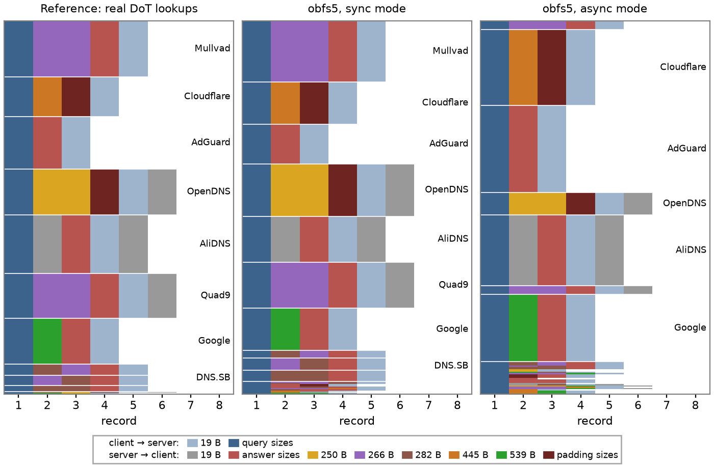

# Training obfsgen on custom reference traffic

obfsgen shapes its traffic after a *reference*: the traffic its models are
trained on. What counts as normal depends on the deployment: the observer, the
network, and the traffic expected there. The reference can be the traffic of a
whole network, one TLS-based protocol, or even the traffic of few selected websites.

This document covers the steps from a chosen reference to a parameter folder
and a running tunnel. Each step gives the general procedure, then the commands
for the [dns-over-tls](../README.md#dns-over-tls) example: DNS-over-TLS (DoT)
lookups to eight public resolvers.

Unlike [campus-gateway](../README.md#campus-gateway), DoT traffic is simple and trains
in minutes on one GPU, so it serves as a quick end-to-end check of the
pipeline.

Commands run from the repository root. The
[requirements](../README.md#requirements) are listed in the README.

## 1. Choose the reference traffic

Three factors shape the choice:

- **What the observer expects.** Traffic that is common and allowed where the
  observer watches: on that network, on the port the server will use.
- **Variety.** The tunnel shows only what the reference shows, so the
  reference should cover every site, client and time of day the tunnel should
  resemble. Varied traffic needs more data and a larger model (step 2).
- **Capacity.** The tunnel's records follow the sizes and timing of the
  reference. Small, short flows carry little data.

Typical choices:

| Reference                       | Select it by                                        | Example                         |
| ------------------------------- | --------------------------------------------------- | ------------------------------- |
| All TLS traffic of your network | a gateway or mirror port,`tcp port 443`           | campus-gateway                  |
| One TLS-based protocol          | its port                                            | dns-over-tls (`tcp port 853`) |
| The traffic of a few websites   | their addresses, or a browser that visits only them |                                 |

**DoT.** The observer sees TCP port 853 and expects DoT there. The reference is
DoT lookups from one client to eight public resolvers, with the common query
types (A, AAAA, HTTPS).

## 2. Capture it

Run the Zeek script [model/capture/obfsgen.zeek](../model/capture/obfsgen.zeek)
on live traffic, or on PCAP files you already have. A capture filter keeps only
the reference. For a capture of days, run the script under zeekctl (see the
[README](../README.md#1-capture-the-reference-traffic-as-zeek-logs)).

**DoT, live.** Start Zeek, produce the traffic, stop with Ctrl-C:

```bash
mkdir -p logs/dot && cd logs/dot && sudo zeek -C -i eth0 -f "tcp port 853" ../../model/capture/obfsgen.zeek
```

Any DoT client produces the traffic, for example
`kdig @9.9.9.9 +tls-ca +tls-hostname=dns.quad9.net example.com A`. For the
example, we looked up the top names of the Cisco Umbrella list, one TLS
connection per lookup to a random resolver, 20 lookups per second for 6 hours.

**DoT, from PCAP files.** Record, then run Zeek over the files:

```bash
mkdir -p traces && sudo tcpdump -i eth0 -w traces/dot.pcap 'tcp port 853'
model/capture/pcaps.sh -o logs/dot/ traces/
```

**DoT, released logs.** To skip the capture, use the logs of our capture in
[datasets/dns-over-tls/zeek](../datasets/dns-over-tls/zeek) (step 3).

**How much to capture.** Enough for the model to converge (step 4). A common
starting point is about 20 training tokens (records) per model parameter
(Hoffmann et al., 2022). Varied traffic needs more data and a larger model;
narrow traffic needs less. Our two examples:

|                                    | campus-gateway               | dns-over-tls                 |
| ---------------------------------- | ---------------------------- | ---------------------------- |
| Capture                            | 33 days                      | 6 hours                      |
| Training tokens, async / sync      | 507 M / 253 M                | 4.46 M / 2.23 M              |
| Parameters                         | 7.1 M (15 blocks, width 256) | 0.57 M (4 blocks, width 128) |
| Tokens per parameter, async / sync | 71 / 36                      | 7.8 / 3.9                    |

DoT repeats a few short record sequences, so 4 to 8 tokens per parameter were
enough. The traffic of a whole network is closer to campus-gateway: start with
the default model and capture days, not hours.

## 3. Build the dataset

```bash
python model/build_dataset.py logs/dot/ -o data/dot/                # your capture
python model/build_dataset.py datasets/dns-over-tls/ -o data/dot/   # the released logs
```

This writes the train, validation and test splits, the two tokenizers and
`opener.json`. From the released logs, it rebuilds exactly the dataset of the
example models: 433,320 connections, 430,736 kept, split 387,712 / 21,594 /
21,430.

## 4. Train the models

Choose the model size for your data (step 2). The defaults in
[model/config.yaml](../model/config.yaml), 15 blocks of width 256, suit the
varied traffic of a network. For DoT, copy the file to `dot.yaml` and change:

```yaml
model:
  n_layers: 4          # default 15
  d_model: 128         # default 256
train:
  chunk_batches: 1     # default 100
```

`chunk_batches: 1` mixes flows of all lengths in each batch. Set it when a
flow's length gives away its kind. In DoT, the length almost tells the
resolver.

Train one model per mode:

```bash
python model/train.py data/dot/ --form async -o runs/dot-async --config dot.yaml
python model/train.py data/dot/ --form sync -o runs/dot-sync --config dot.yaml
```

For DoT, 20 epochs took 15 and 8 minutes on a RTX 5090 GPU.

Then read `log.csv` in each run directory. The model has converged when the
validation loss has flattened and stays close to the training loss. If the
validation loss still falls, train longer. If the training loss falls well
below it, capture more data or use a smaller model.

## 5. Export the parameter folder

```bash
python model/export.py --async runs/dot-async --sync runs/dot-sync --data data/dot/ -o params/my-dot/
```

`params/my-dot/` now holds everything the endpoint needs.

## 6. Run the tunnel

Build the client, and the server package with your parameter folder:

```bash
CGO_CFLAGS="-O3 -march=native" go -C endpoint build -o ../obfsgen .
PARAMS=params/my-dot ZIG="python3 -m ziglang" endpoint/scripts/build-server.sh
```

On the server, install the package on the reference's port, here DoT's:

```bash
sudo PORT=853 NAME=dns.example.org ./install.sh
```

On the client, use the IP, PIN and PSK that `install.sh` printed. For DoT, use
synchronous mode: some resolvers send records before the query reaches them,
while an asynchronous server always waits for the client's first record.

```bash
printf 'client:\n  mode: sync\n' > client.yaml
printf %s 'PSK' > psk
./obfsgen client -config client.yaml -params params/my-dot -server IP:853 -sni dns.example.org -pin PIN -psk-file psk
```

Each DoT connection plays one lookup, so it carries little data: about 15
bytes from the client and a few hundred from the server.

## 7. Check the tunnel's traffic

Capture the tunnel with Zeek as in step 2, into `logs/tunnel/`. Then score it
next to the reference's test split:

```bash
python model/score.py params/my-dot/sync logs/tunnel/ -o tunnel.csv
python model/score.py params/my-dot/sync data/dot/test.parquet -o test.csv
```

Lower scores are closer to the reference. The tunnel's scores should fall in
the same range as the test flows' scores.

## 8. A glance into generated DoT flows

300 flows generated from each model in
[params/example/dns-over-tls](../params/example/dns-over-tls) (async with a
30 ms round trip), next to 300 real test flows. Each row is a flow and each
cell is a record, coloured by its size and direction. Rows with the same
record pattern are grouped and labelled with the resolver the pattern belongs
to. In both modes, the generated flows follow the record patterns of the
reference.



In the legend, query and answer sizes are the DNS query and the unpadded
answer, whose sizes vary with the name looked up. A 19 B record carries two
bytes, such as the closing alert. The records of 250, 266, 282, 445 and 539 B
are session tickets, whose sizes each resolver fixes, and the padding sizes
(487, 955 and 1423 B) are answers that Cloudflare and OpenDNS pad to blocks of
468 bytes.
